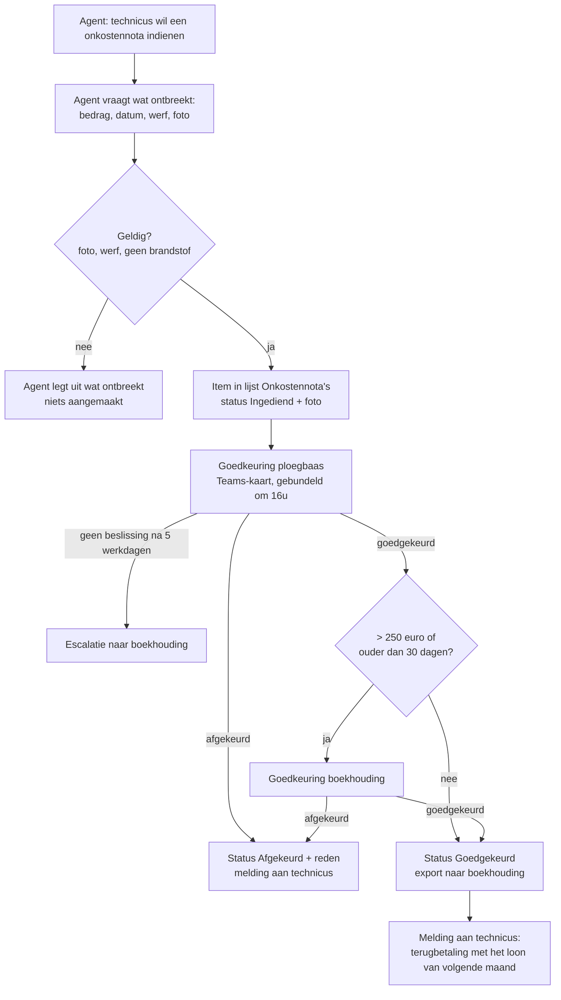

# Agent flow "Onkostennota indienen"

> Wat is dit: het functioneel en technisch ontwerp van de tool die Brevan Assist aanroept. Voor wie: de bouwer, de boekhouding en de ploegbazen. Waarom: hier zit geld, dus hier beslist een mens en is elke stap controleerbaar.
> Vorige: [Bouwspecificatie](../04-design/bouwspecificatie.md) · Volgende: [06 — Testen en evalueren](../06-test/teststrategie-en-evaluatie.md)

De regels hieronder staan ook als code in [`flow.mjs`](../../site/assets/lib/flow.mjs) en worden getest in [`tests/flow.test.mjs`](../../tests/flow.test.mjs). De demo (tab "Agent") toont een gesimuleerde run met event-log.

## Verloop

## Inputs (gevraagd door de agent)

| Input | Type | Regel | Waarom |
|---|---|---|---|
| bedrag | getal (€) | > 0 | |
| datum | datum | uitgave; ouder dan 30 dagen → boekhouding moet akkoord geven | onkostenbeleid, "Termijn" |
| werf | tekst | werfadres of klantnaam; **geen projectcode** | R5, [ADR-002](../adr/002-geen-erp-koppeling-in-poc.md) |
| bewijsstuk | bestand (foto) | verplicht | onkostenbeleid, "Bewijsstuk" |
| categorie | keuze | werfaankoop, parking, tol, maaltijd; brandstof → geweigerd (tankkaart) | onkostenbeleid, "Wat wordt terugbetaald" |

Met generative orchestration vraagt de agent zelf naar ontbrekende inputs; de flow controleert ze opnieuw. **De flow vertrouwt de agent niet**: alle regels die geld raken, zitten in de flow, niet in de instructies.

## Lijst *Onkostennota's* (SharePoint)

`Medewerker` (persoon) · `Bedrag` · `Datum uitgave` · `Werf` · `Categorie` · `Bewijsstuk` (bijlage) · `Status` (Ingediend, Goedgekeurd ploegbaas, Goedgekeurd, Afgekeurd, Geëscaleerd) · `Ploegbaas` · `Reden afkeuring` · `Correlatie-ID`

Rechten: een medewerker ziet alleen zijn eigen items; ploegbazen zien de items van hun ploeg; de boekhouding ziet alles.

## Goedkeuring

| Regel | Waarde | Waarom |
|---|---|---|
| Altijd | ploegbaas | onkostenbeleid, "Goedkeuring" |
| Bedrag > €250 of ouder dan 30 dagen | + boekhouding (na de ploegbaas) | onkostenbeleid; drempel als environment variable `brv_Onkosten_FinanceLimit` |
| Ploegbaas afwezig | vervangende ploegbaas | onkostenbeleid |
| Melding | één gebundelde Teams-kaart per dag om 16 uur | R4, [ADR-003](../adr/003-goedkeuring-gebundeld-in-teams.md) |
| Geen beslissing na 5 werkdagen | escalatie naar de boekhouding | R4 |

Lange goedkeuringen wachten niet in één flow-run: de status staat in de lijst en een dagelijkse flow verstuurt de bundel en escaleert. Zo hangt niets af van een run die dagen openstaat ([Microsoft: long-running approvals](https://learn.microsoft.com/en-us/power-automate/create-long-running-approvals)).

## Foutafhandeling

| Fout | Wat de flow doet | Wat de gebruiker ziet |
|---|---|---|
| Upload van de foto mislukt | *Try*-scope faalt → *Catch*: item niet aangemaakt, fout gelogd met correlatie-ID | "Het indienen lukte niet. Probeer opnieuw; je nota is nog niet verstuurd." |
| SharePoint niet bereikbaar | retry-beleid (standaard 4×), daarna *Catch* | idem |
| Ploegbaas niet gevonden (Office 365 Users) | naar de boekhouding als goedkeurder, melding aan HR | "Je nota is ingediend en gaat naar de boekhouding." |
| Dubbele indiening (zelfde bedrag, datum, werf binnen 10 min) | tweede wordt niet aangemaakt | "Deze nota is al ingediend." |

## Eigenaarschap en ALM

- In de solution `BrevanAssist`, met connection references; in productie eigendom van `svc-powerplatform`.
- Wijzigingen alleen in *Brevan-Dev*, via de pipeline naar Test en Productie ([governance](../07-govern/governance-pakket.md)).
- Business owner van de regels: financieel verantwoordelijke.
